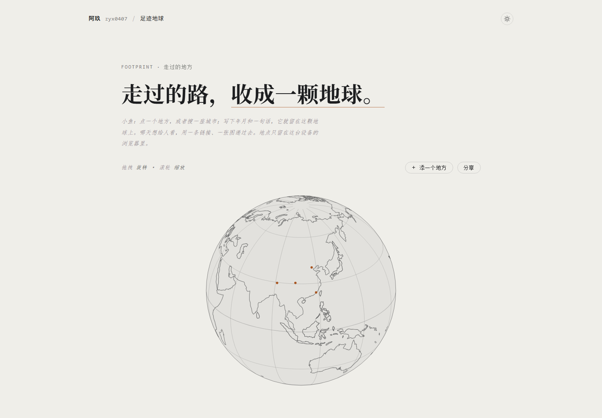

# 足迹地球 · Footprint Globe

把去过的地方，收成一颗地球。

在线地址 → <https://work2.zyx0407.com/>
纯静态 · 单文件 · 零依赖 · 零构建（连二维码都是自己写的）



## 这是什么

一颗线稿地球。点一个地方、或者搜一座城市，写下年月和一句话，它就留在地球上；攒够几个，可以把这个网页和一张预览图分享给别人。

## 页面上有什么

- **搜地名**：内置 763 个城市（中文名 / 拼音 / 国家 / 坐标），选中就把地点落好；找不到还能在地球上自己点一个点。
- **线稿地球**：手写的正交投影，大陆轮廓 + 30° 经纬网；可拖拽旋转（带惯性）、滚轮缩放；落点是琥珀色的点，选中会出现纸签标签。
- **条目**：等宽编号 + 宋体地名 + 年月与经纬度；点条目地球会转过去，可编辑、删除（删除点两次确认）。
- **日夜**：暖纸 / 深色展厅两套配色，默认跟随系统，可手动切换并记住。
- **分享**：分享的是「这个网页的链接 + 一张 1080×1440 预览图」，预览图永远浅色、带网页二维码；**不带你的地点与署名**，0 个地点也能分享。
- **数据**：只存在你自己的浏览器 `localStorage`（键 `footprint-globe:v1`）；换设备用页脚「导出 / 导入 JSON」。

## 三行上手

双击 `index.html` 就能跑（纯静态，`file://` 也行）；要一个本地端口的话，用任意静态服务器指到这个目录即可，例如：

```powershell
npx serve .
```

## 数据与隐私

- 地点只在本机浏览器，不上传、不统计；页面不加载任何第三方脚本、不请求外部资源。
- 分享链接就是这个网页的地址，不携带任何地点信息；预览图是同一条链接的二维码 + 通用版式。
- 换电脑 / 换浏览器时，用「导出 JSON」带走，新机器「导入 JSON」。

## 数据来源与技术

- 大陆轮廓：Natural Earth 110m（公有领域），内嵌在页面里，约 5,100 个点。
- 地名库：Natural Earth 10m populated places（公有领域），中国 400 个城市 + 各国首都与人口 150 万以上城市，共 763 条。
- 二维码：自写的零依赖编码器（字节模式、纠错等级 M、版本 1–20，最多 666 字节）。
- 单文件 `index.html`，无构建、无第三方库、零网络字体。

## URL 参数

| 参数 | 作用 |
| --- | --- |
| `?theme=day` / `?theme=night` | 强制某一配色，不写入本地存档 |
| `?nofade=1` | 关过渡（截图 / 出图用） |

## 文件

| 文件 | 是什么 |
| --- | --- |
| `index.html` | 全部：页面、样式、线稿地球、地名库、二维码 |
| `screenshot.png` | 首页截图 |
| `CNAME` | 部署用的自定义域 `work2.zyx0407.com` |

## 说明

- 页面不做任何统计，分享靠链接与图片自己转。
- 本仓库未附开源许可证：代码与页面保留所有权利。
